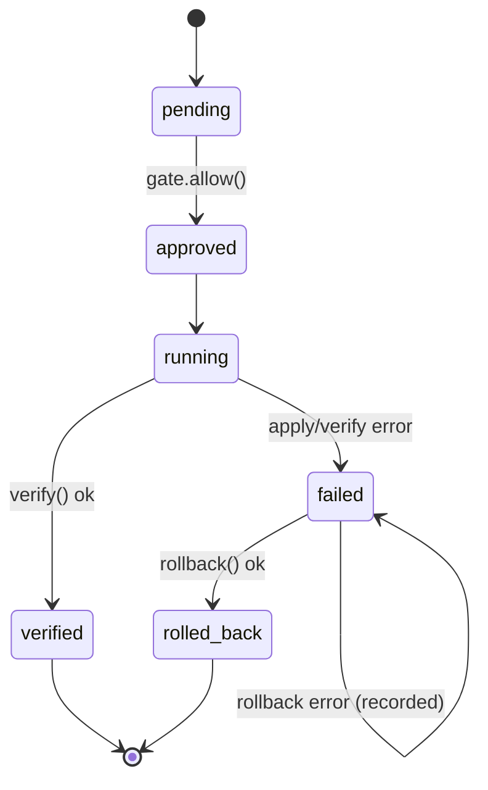

# macos-privacy-cli — Automation Design (graph-driven, durable)

> Companion to `docs/plans/2026-11-17-macos-privacy-cli-architecture-plan.md` (master plan).
> Depends on the control registry and privilege broker defined in `docs/technical/macos-privacy-cli-target-architecture.md`.

## 1. Workflow schema v2

`workflows.py` keeps its human-readable philosophy (steps as concepts) but every step gains a machine binding:

```python
WORKFLOW_SCHEMA_VERSION = "2.0"

@dataclass(frozen=True)
class ControlStep:
    id: str
    control_id: str                  # resolves through controls.py
    action: Literal["check", "apply", "verify", "rollback"]
    depends_on: tuple[str, ...] = ()   # DAG edges
    on_failure: Literal["stop", "continue", "rollback", "retry"] = "stop"
    max_retries: int = 0
    approval: Literal["auto", "confirm", "dangerous"] = "auto"  # fed to gate

@dataclass(frozen=True)
class Workflow:
    id: str
    title: str
    description: str
    steps: tuple[ControlStep, ...]
    schedule_hint: str | None = None   # e.g. "daily"; execution stays user-triggered in Phase 2
```

`BUILTIN_WORKFLOWS` (daily, incident, harden, evidence) are re-declared as DAGs over control ids. `chain.py`'s duplicate "daily" is retired in favor of the executor (audit O-2). `--dry-run` remains available but is no longer the permanent default; without it the executor still refuses anything the gate refuses.

## 2. Execution state machine & persistence

Per-run directory: `~/.msp/state/runs/<run_id>/` containing `run.json` (workflow id, input params, started ts), `steps/<step_id>.json` (status, attempts, result finding refs, approval token refs), `events.jsonl` (append-only audit trail). Statuses: `pending → approved → running → verified | failed → rolled_back | skipped`.



## 3. Executor pseudocode

```python
def execute(workflow, params, *, approver, resume_run_id=None):
    run = load_or_create_run(workflow, params, resume_run_id)
    for step in topo_order(workflow.steps):
        if step_status(run, step) in ("verified", "skipped", "rolled_back"):
            continue                                  # crash-resume: skip completed
        decision = gate.decide(step, run, approver)   # engine-enforced
        if decision.denied:
            mark(run, step, "skipped", reason=decision.reason); continue
        mark(run, step, "running")
        capture_pre_state(step, run)                  # for rollback
        for attempt in range(step.max_retries + 1):
            try:
                result = controls[step.control_id].apply(params)   # via privilege broker
                verification = controls[step.control_id].verify(result)
                if verification.ok:
                    mark(run, step, "verified", result=result, verification=verification)
                    break
                raise VerifyError(verification)
            except Exception as err:
                if attempt < step.max_retries:
                    sleep(backoff(attempt)); continue   # reuse sdk.retry_with_backoff
                if step.on_failure == "rollback" and rollback_captured(run, step):
                    rollback(run, step); mark(run, step, "rolled_back", error=str(err))
                else:
                    mark(run, step, "failed", error=str(err))
                if step.on_failure in ("stop", "rollback"): return run
    return run
```

Crash-resume falls out of the state files: a new invocation with `msp workflow resume <run_id>` (or automatic on next `run` of the same workflow) re-reads `steps/*.json`, skips terminal states, and continues from the first non-terminal step. Stale `running` steps (crash mid-mutation) are marked `interrupted` and re-verified before re-apply — if `verify()` is satisfied, the step is already done and marked `verified` without re-running `apply`.

## 4. Approval gate (engine-enforced)

`src/gate.py` — the single choke point every mutating path passes (`remediate.apply_plan`, workflow executor, TUI actions, `doctor fix`):

- Risk classes from `ControlSpec.safety`: `read` (never gated), `safe_write` (auto, logged), `confirm` (requires interactive y/N or a valid approval token), `dangerous` (requires approval token + target binding; TUI shows full diff/target).
- Approval tokens: short-lived (TTL), scoped to (control_id, target hash, run_id), stored in the ledger. A CLI `--yes <token>` and a TUI approval-inbox both mint tokens through the same `gate.approve()` API — the TUI's `_requires_confirmation` allowlist is deleted once controls carry `safety` (its known misses — `shell repair`, `fswatch` baseline, `forensics clean`, `chain run`, `ai configure` — are covered by the registry).
- Non-interactive contexts (no TTY): `confirm`/`dangerous` steps are refused with exit code 2 and a machine-readable "requires approval" result, never executed silently.

## 5. Walkthrough — crash-resume

1. Operator starts `msp workflow run harden`. Executor writes `run.json` + step states.
2. Step `FW-001.apply` runs via broker; machine sleeps mid-sudo. Process dies; state file still says `running`.
3. Later, `msp workflow run harden` detects the interrupted run, marks the stale step `interrupted`, runs `FW-001.verify()` — global firewall state is now `on`, so the step is marked `verified` (no double-apply). Remaining DAG continues from the first non-terminal step.

## 6. Walkthrough — failed remediation with rollback

1. Step `GK-001.apply` (`spctl --master-enable`) reports success.
2. `verify()` re-queries gatekeeper status and returns `ok=False` (e.g., status read raced or policy blocked).
3. Executor consults `capture_pre_state` (recorded e.g. `master-disable` on a dev host) and runs `rollback` — restoring *the recorded pre-state*, never a hardcoded opposite (this specifically fixes the `--master-disable` rollback downgrade noted in the repository evidence).
4. Step is marked `rolled_back` with both findings attached; workflow stops per `on_failure`; the doctor surface surfaces "1 step rolled back — review `msp workflow show <run_id>`".
