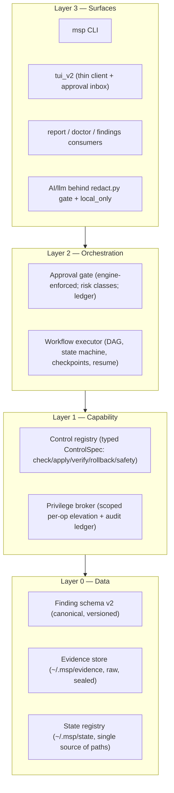

# macos-privacy-cli — Target Architecture

> Companion to `docs/plans/2026-11-17-macos-privacy-cli-architecture-plan.md` (master plan).
> Evidence base: `docs/technical/macos-privacy-cli-repository-evidence.md`; trust rationale: `docs/technical/macos-privacy-cli-threat-model.md`.



## F1 — Control registry (`src/controls.py`)

The central design gap ("no typed control catalog"). Every capability — each of the 10 rules, each scanner check, each remediate mapping, each preset setting — is declared as a `ControlSpec`:

```python
@dataclass(frozen=True)
class ControlSpec:
    control_id: str          # e.g. "FW-001"
    domain: str              # firewall | tcc | shell | network | privacy | storage | sandbox
    title: str
    check: CheckFn           # -> Finding v2 (with evidence refs)
    apply: ApplyFn | None    # -> mutation via privilege broker
    verify: VerifyFn | None  # re-reads state; must be independent of apply
    rollback: RollbackFn | None  # restores pre-state captured by apply
    safety: Literal["read", "safe_write", "confirm", "dangerous"]
    requires_privilege: Literal["none", "admin"]
    profiles: frozenset[str]
    refs: tuple[str, ...]    # CIS/NIST/STIG citations
```

Rules, scanner checks, remediation mappings, presets, and TUI verbs all *resolve through* `controls.py` — they stop being parallel inventories. `SEC-001` is implemented or deleted. Presets become `{control_id: target_state}` maps; `apply_preset` becomes a workflow over control steps, gaining per-setting verification and rollback for free.

## F2 — Finding schema v2 (canonical)

One shape, versioned, already half-built by Phase 1's bundle entry. Extend it with: `evidence` (list of sealed evidence refs), `provenance` (collector version, command args, timestamp), `incomplete` flag + `reason` (fixes TCC silent degradation), `verified` (post-apply verification result), `control_id`. The other three shapes are adapted to emit v2 (audit O-4 closed).

## F3 — Privilege broker (`src/privilege.py`)

Normalizes the five idioms behind one API: `run_privileged(argv, why)` → (a) argv-validated command list only (no shell strings), (b) elevation via the `firewall.py` AppleScript pattern per operation, (c) append-only ledger entry in `~/.msp/state/privilege_ledger.jsonl` (timestamp, argv, why, caller run_id, result rc). `command.run_command` loses the literal-sudo branch; modules migrate call-site by call-site. `shell=True` strings in `privacy_settings.py` are converted to argv lists in the same pass as the substring-verdict bugfixes.

## F4 — Evidence & state discipline

`src/state.py` defines every path under `~/.msp/` once (reports, scans, backups, baselines, snapshots, state, evidence, ledger, ai config), with versions and a tiny migration hook. `deps.json` moves to `~/.msp/deps.json` (repo tree stops getting dirtied). Raw evidence is stored unredacted but *sealed* (owner-only perms, hash chain optional); redaction applies at render/export boundaries and to anything crossing the LLM gate. The blanket IP redaction in `command.run_command` becomes opt-in (`--redact-ips`) for shared/exported output — default output keeps structure while v2 findings keep both a redactable display field and raw evidence refs.

## F5 — AI gate

One registry (ai/llm/sdk unified, audit O-3), dead block at ai.py:998 deleted, `local_only` enforced in code (refuse OpenAI path when set), and every outbound payload passes `src/redact.py` (the G-8/G-23 module already specified in `docs/plans/utility-expansion.md` A4).

## TUI architecture

See `docs/technical/macos-privacy-cli-tui-plan.md`.
